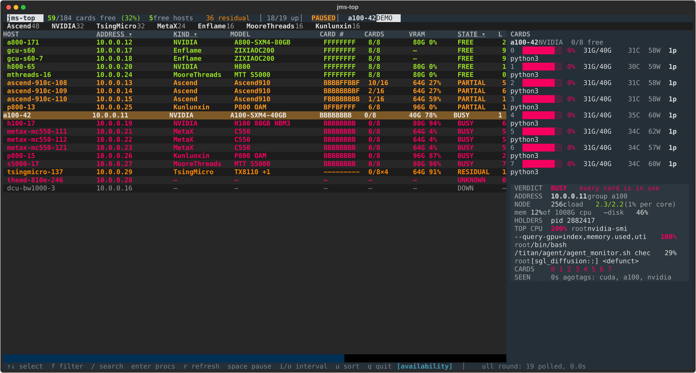

# jms-top

A live terminal view of a JumpServer fleet — nvitop's feel, for the one question that
matters before you start a job: **which of my machines can I actually take right now?**



```
  jms-top    488/760 cards free  (64%)   40 free hosts   12 residual  │ 74/77 up │ next tick in 2.1s · full 8s ago
 Ascend 192  NVIDIA 208  Hygon 72  Enflame 64  Iluvatar 64  MooreThreads 48  MetaX 32  T-Head 32  TsingMicro 32  Kunlunxin 16
 HOST             ADDRESS    KIND          MODEL           CARD #            CARDS  VRAM     STATE     LOAD  MEM  CPU  UP       USERS              AGE
 a800-171         10.0.0.12  NVIDIA        A800-SXM4-80GB  FFFFFFFF          8/8    80G 0%   FREE      2%    8%   39%  126d7h   root               0s
 h800-65          10.0.0.20  NVIDIA        H800            FFFFFFFF          8/8    80G 12%  FREE      1%    17%  12%  135d2h  root               0s
 ascend-910c-108  10.0.0.13  Ascend        Ascend910       BBBBFFBBFFFFFFFF  10/16  64G 41%  PARTIAL   5%    17%  2%   79d1h   pid 2510883,pid 2  0s
 p800-13          10.0.0.33  Kunlunxin     P800 OAM        BFFBFFFF          6/8    96G 9%   PARTIAL   1%    5%   0%   72d3h   pid 2598031,pid 2  0s
 bw1100-2         10.0.0.91  Hygon         BW1101 144GB    FFFFFFFF          8/8    144G 0%  FREE      0%    2%   0%   30d     root               0s
 tx8110-137       10.0.0.71  TsingMicro    TX8110-256-00   ~~~~…             0/8×4  64G 91%  RESIDUAL  1%    8%   0%   5d5h    root               0s
 h100-17          10.0.0.61  NVIDIA        H100            BBBBBBBB          0/8    80G 91%  BUSY      6%    25%  4%   76d21h  pid 1062720,pid 1  0s
```

`CARD #` is one character per device, so "can I get four cards on one host?" is a glance
rather than eight numbers read one at a time.

| symbol | means |
|---|---|
| `F` | free — nothing running, memory clear |
| `B` | busy — a process holds it, or its memory is committed |
| `~` | **residual** — no process listed but memory is held (a leaked or paused job) |
| `?` | unknown — the vendor tool did not answer; **never** reported as free |
| `—` | not reported at all |

---

## Install

```bash
git clone https://github.com/lvyufeng/jms-top && cd jms-top
python3 -m venv .venv && .venv/bin/pip install -e ".[dev]"
ln -s "$PWD/.venv/bin/jms-top" ~/.local/bin/jms-top   # so `jms-top` works anywhere
```

Or with [pipx](https://pipx.pypa.io) if you do not want a dev checkout:

```bash
pipx install .
```

**Self-contained.** No other package is needed: config, login, the KoKo SSH data plane
and every vendor parser live in this repo.

## Setup (once)

```bash
jms-top init          # writes ~/.config/jms-top/{config.toml,hosts.yaml}
```

Edit `config.toml` — it needs three lines:

```toml
[bastion]
url = "https://jumpserver.example.com"   # the web UI's address
ssh_port = 2222                          # KoKo's SSH port (some use 2224)
login = "your-login"                     # your JumpServer *login*, not the OS account
```

Then log in and discover your machines:

```bash
jms-top login                     # prompts for the password, never echoes it
jms-top hosts --discover --write  # list the assets you may use, write hosts.yaml
jms-top --ping                    # is everything reachable? (seconds, not a full round)
```

`login` exchanges your password at `POST /api/v1/authentication/auth/` and caches the
returned **session token** in `config.toml`, so later runs reuse it. `jms-top logout`
drops it; `--save-password` keeps the password in a 0600 file instead.

`--discover` asks **KoKo** (the same SSH gateway the poller uses), so it lists exactly
the machines that will answer. `--discover-api` asks the REST API instead, which returns
everything you are *permitted* — including assets under repair or not yet activated,
which show up as `DOWN`. Use the KoKo list.

Asset names like `bm-baai-dx-zone1-d-a100-40g-2-42` become short keys (`a100-42`) with
the rest kept as tags and groups (`jms-top a100`, `jms-top zone1`).

### Things that go wrong

| symptom | cause | fix |
|---|---|---|
| `--ping` says DOWN, message says *no permission* | your account cannot log in to that asset | ask for it in JumpServer |
| `--ping` says DOWN, message says *asset offline* | KoKo cannot reach it | not your problem — it is listed in the bastion as down |
| `login` refused | wrong password, or a locked account | the message is the bastion's own words |
| every host DOWN with a password error | KoKo wants a key, not a password | register an SSH key; see below |

An SSH key is better than a password: register it with JumpServer and leave
`ssh_password` unset. Otherwise put the password under `[bastion] ssh_password` (or
`JMS_TOP_SSH_PASSWORD`) and install `sshpass`.

### Your own files

| file | holds |
|---|---|
| `~/.config/jms-top/config.toml` | bastion URL, KoKo port, login, cached token |
| `~/.config/jms-top/hosts.yaml` | which machines exist (name → asset id, account, platform, tags, groups) |

Both are mode 600 in a 700 directory. Relocate either with `JMS_TOP_CONFIG` /
`JMS_TOP_INVENTORY`.

Coming from a **jms-bridge** inventory? It is the same `hosts.yaml` *shape* — copy the
hosts and groups across; the fields jms-top does not use (`env_setup`, `workdir`,
`workspaces`) are ignored. Or regenerate it with `jms-top hosts --discover --write`.

---

## Running it

```bash
jms-top
```

Type `q` to quit. The title bar starts at `starting…`: it pings every host, then runs a
first full round. On the 77-host fleet here that is **60–80 s**; afterwards the CPU side
refreshes every 3 s and each host's card table on its own schedule.

### Choosing what to watch

```bash
jms-top                     # everything in the inventory
jms-top ascend              # one group
jms-top metax,ascend        # several selectors, comma-separated
jms-top h100-17 gpu         # a host name and a tag together
jms-top -t ascend -t metax  # same thing, spelled the long way
jms-top 'metax, p800'       # spaces are fine too — quote them for the shell
```

A selector is a **host name**, a **group name**, or a **tag** — whatever appears in
`hosts.yaml`. An unknown selector is an error that lists the known names, rather than a
silently empty screen.

### Keys

| key | does |
|---|---|
| `↑` `↓` / `j` `k` | move the selection (the side panel and detail follow immediately) |
| `f` | cycle the filter: all → free → partial → residual → busy → down/unknown |
| `/` | search host, tag, group, platform, user, process name — filters as you type, `enter` keeps it, `esc` closes |
| `enter` | open the selected host's accelerator process list |
| `esc` | close the process list, or the search box |
| `r` | run a full round now |
| `space` | pause / resume polling (the screen keeps showing what it has) |
| `i` / `o` | poll **slower** / **faster** (interval ×2 / ÷2, clamped to 1–60 s) |
| click `ADDRESS` / `KIND` / `STATE` | sort by address / group by vendor / group by state (click again → back to availability) |
| `ctrl+r` | reload the UI from source now (normally automatic) |
| `q` | quit |

### Tuning the poll rate

```bash
jms-top -i 2                   # a 2 s CPU tick (also: press `i` / `o` while running)
jms-top -f 30                  # re-read card tables every 30 s
jms-top --timeout 20           # lower the per-SSH-command ceiling
```

Two speeds, deliberately. The **CPU tick** (`-i`, default 3 s) reads `/proc`, `ps` and
`who` — about a second per host. The **card tick** (`-f`, default 60 s) runs the vendor
tools, which are the expensive half. A host stays at the card rate while it has
something free and drops to 3× slower once nothing is free, because a busy card stays
busy. The `AGE` column always says how old a card table is.

Going below `-i 2` buys nothing: the CPU tick alone measured 1.2–3.4 s wall per round,
so a 1 s interval just queues rounds back to back.

### Hot reload

Edit `panels.py`, `render.py`, `tui.py` or `app.tcss` while the app runs and the screen
picks it up within a second, **without losing the connection or the data**: the monitor
keeps its multiplexed SSH channels and its last round; only the widgets are
re-composed. `ctrl+r` forces a reload.

Changes to `monitor.py`, `probe.py`, `families.py` or `scan.py` are **not** hot-swapped —
those hold state that in-flight SSH commands are using — and the footer says
`restart to apply monitor/parser changes` when it sees one. `--no-watch` disables the
watcher.

---

## Scripting it

```bash
jms-top --once                 # one full round, printed as a table
jms-top --ping                 # is everything reachable? (seconds, not a full round)
jms-top -t h100-17 --once      # one host
jms-top --once --json | jq .summary
```

`--json` emits the whole fleet: per host its verdict, cards, processes, users, load,
memory, and the timestamp the numbers are from. That is what to pipe into a scheduler or
an alert — not the table.

```bash
jms-top --demo                 # the real UI on a recorded fleet — no SSH, no account
```

Useful for trying the keys and for screenshots: it replays
`tests/fixtures/demo/fleet.json` through the same parsers and the same app, so what you
see is what the real thing does with that data.

---

## Reading the verdicts

| verdict | when |
|---|---|
| `FREE` | every card free, and the CPU side is idle (< 0.75 load per core) |
| `PARTIAL` | some cards free; or all free but the node is CPU-busy |
| `BUSY` | at least one card is in use |
| `RESIDUAL` | every card is held by memory alone — no process, no compute |
| `UNKNOWN` | the vendor tool errored or was cut off; the reason is in the detail panel |
| `DOWN` | the bastion refused the connection (no permission, asset offline) |
| `CPU` | reachable, no accelerator tool answered |

Per card: busy if a process holds it, or its health is not OK, or ≥ 50 % of its memory
is committed, or utilisation ≥ 5 %. Free only when a signal says so — no signal at all
means unknown.

Three rules shape all of this:

1. **A missing value is never a zero.** Anything not reported renders as `—`, and a card
   whose numbers did not parse is `?` (magenta), never `F` (green).
2. **A card is busy the moment its memory is committed.** Process table first, then
   memory, then utilisation — because on a shared cluster memory, not utilisation,
   decides who can start next. A vLLM stack at `0 %` utilisation holding 87 % of the HBM
   is busy, and `RESIDUAL` exists to call that state out by name.
3. **Count the unit a job actually asks for.** Ascend 910C reports 2 chips per card and
   TsingMicro 4 per card. Devices are counted (that is what you ask for) with the board
   count alongside — `0/8×4` means 8 boards of 4 chips.

## Accelerator support

| family | tool | reported per | notes |
|---|---|---|---|
| NVIDIA | `nvidia-smi` | GPU | processes with bus ids |
| Ascend | `npu-smi info` | chip (2/card on 910C) | processes |
| Kunlunxin | `xpu-smi` | XPU | processes |
| MetaX (沐曦) | `mx-smi` | GPU | `--show-memory/usage/process`, falls back to the default table |
| Enflame | `efsmi` + `pmon` | GCU | processes |
| Moore Threads | `mthreads-gmi` | GPU | processes |
| TsingMicro (清微) | `tsm_smi` | chip (4/card on TX8110) | card id appears on the card's first chip row only |
| T-Head (平头哥) | `ppu-smi` | PPU | off `PATH` — `/usr/local/PPU_SDK/ppu-smi/bin` |
| Iluvatar (天数) | `ixsmi` | GPU | needs `LD_LIBRARY_PATH` from its own tree; the install dir is **versioned** on some hosts (`/usr/local/corex-4.5.0…/bin`) |
| Hygon (海光) | `hy-smi` | DCU | `/opt/hyhal/bin`; memory from sysfs, processes from KFD |

**Off-PATH is the norm, not the exception** — four of these tools are not on `PATH` and
one ships under a version-numbered directory. Every probe searches the known locations
rather than trusting `PATH`.

Two vendor quirks worth knowing:

* **Hygon's `hy-smi` reports memory only as a percentage**, and the same one on every
  card. A machine with a job on each of eight cards prints `VRAM% 73` eight times, which
  cannot tell "one process using 73 %" from "eight processes". It also has no process
  table at all. Both gaps are filled from the kernel: exact bytes from
  `/sys/class/drm/card*/device/mem_info_vram_*`, processes from
  `/sys/class/kfd/kfd/proc/*`. KFD says a process holds a queue but not which card runs
  it, so that list is host-wide, not per-card.
* **Some process tables lie.** TsingMicro declines to list processes while 32 chips
  report "taskNum exceeds max", so those cards are judged on memory alone.

Which tool to run is decided by the host, not the inventory: every family is probed
behind a `command -v` guard and reports under its own `##FAMILY` marker, so a machine
that is mislabelled in `hosts.yaml` still lands on the right parser.

Every parser is pinned by a test against output captured from the real fleet
(`tests/fixtures/smi`), and the tests assert the *judgement* — which cards are free,
which are held by memory alone, which host must be `unknown` — not just the numbers.

## What the probe costs

Measured on the live fleet:

| | |
|---|---|
| CPU consumed by the probe (incl. the vendor tool) | 0.2 – 1.4 CPU-seconds per host per full round |
| share of a 256-core host | well under 1 % |
| jms-top's own CPU | **0.4 %** steady, **2.9 %** during a first scan |
| accelerator memory / SM time taken | none |
| bytes returned | 1–11 KB per host |

The probe reads counters — `/proc`, `ps`, and the vendor's management interface. It takes
no accelerator memory, creates no context, and runs no kernel, so a training job's
throughput is unaffected. What it does touch is the card's own utilisation sampling,
which is the same small perturbation `nvidia-smi` always has.

Two things keep it bounded:

* **Every vendor call is time-boxed** (6 s; 12 s for the NVIDIA query, whose host was
  measured at 9–11 s). A cut-off tool reports `##STALLED`, and that host reads `UNKNOWN`
  with the reason on screen — a hung driver costs one host one round, never the fleet.
* **The first scan is serialised in batches of 4.** 77 hosts over one bastion is
  ~60–80 s, which is SSH round-trip latency, not compute. It is why the screen fills in
  progressively instead of waiting for everything.

## Limits worth knowing

* **A card's holder is a pid, not a user.** The vendor tools do not report ownership and
  these hosts run everything as `root`. Use the bastion's audit log to learn who it was.
* **The CPU tick cannot see a card go idle.** A host's card verdict is at most one full
  interval old; `AGE` says exactly how old.
* **`nvidia-smi` is slow on some hosts** (9–11 s on one H800 here, against 0.3 s
  elsewhere), so the GPU query gets 12 s; a slower answer is reported as `UNKNOWN` rather
  than guessed.
* **Hygon's `--showproductname` disagrees across SKUs** — `BW1101` on one box, `BW` on
  another. The series name is kept and the capacity appended, rather than inventing a
  model.

## Development

```bash
pytest                 # 141 tests, no cluster and no bastion required
ruff check src tests
jms-top --demo         # the recorded fleet, in the real UI
```

`docs/architecture.md` explains the layering and why there are two poll speeds.
`tests/fixtures/demo/fleet.json` is a captured fleet; `demo.py` replays it through the
same parsers and app as live data, so neither the tests nor the demo can drift from it.

Layout:

```
config.py    TOML config, 0700/0600, token cache
auth.py      REST login, asset listing
inventory.py hosts.yaml parsing, selectors, writing a discovered inventory
discover.py  KoKo pty session, asset paging, name → key
ssh.py       ControlMaster data plane, one multiplexed session per host
probe.py     the remote script, per-family guards, sentinel
families.py  one parser per accelerator vendor
scan.py      probe reply → HostView; family attribution
monitor.py   poll loop: CPU tick, card tick, batching
tui.py       Textual app, columns, sorting, keys
render.py    plain-text table for --once
```

---

## For agents

If you are an automated agent installing or driving jms-top, this is the short version.

**Install** (no bastion needed to verify it works):

```bash
git clone https://github.com/lvyufeng/jms-top && cd jms-top
python3 -m venv .venv && .venv/bin/pip install -e ".[dev]"
.venv/bin/pytest -q          # expect 141 passed, ~7 s, no network
.venv/bin/jms-top --demo --once | head -5   # the UI renders against a recorded fleet
```

**Configure** — three values, no interactive step required:

```bash
.venv/bin/jms-top init                                  # idempotent, writes both files
# then set [bastion] url / ssh_port / login in ~/.config/jms-top/config.toml
JMS_TOP_PASSWORD=… .venv/bin/jms-top login              # or pass --password on stdin
.venv/bin/jms-top hosts --discover --write              # populate hosts.yaml
.venv/bin/jms-top --ping                                # expect every host UP
```

**Read the fleet** — never parse the table:

```bash
jms-top --once --json    # the whole fleet as JSON
```

Top level: `generated_at`, `interval`, `summary`, `hosts[]`.

```jsonc
{
  "summary": { "hosts", "reachable", "free_hosts", "free_cards",
               "busy_cards", "unknown_cards", "total_cards", "families" },
  "hosts": [{
    "host": "a100-42",           // the inventory key — not "name"
    "platform": "nvidia",
    "address": "10.1.2.42",
    "tags": [...], "group": "...",
    "reachable": true, "error": null, "latency_s": 0.4,
    "updated_at": "2026-10-22T05:20:09+00:00",
    "verdict": "free",           // lowercase: free | partial | busy | residual
                                 //            | unknown | down | cpu
    "accel": {                   // null on a CPU-only or unreachable host
      "family": "nvidia", "label": "NVIDIA",
      "card_name": "NVIDIA A800-SXM4-80GB",
      "total": 8, "free": 8, "busy": 0, "unknown": 0, "residual": 0,
      "error": null,
      "cards": [{ "index", "name", "util", "mem_used", "mem_total",
                  "temp", "power", "health", "procs": [{"pid","user","name"}] }]
    },
    "node": { "hostname", "cpus", "load": [1,5,15], "load_per_cpu",
              "mem_pct", "mem_total_mib", "cpu_pct", "uptime_s", "logins": [...] }
  }]
}
```

Memory is in **MiB**. `card.busy` is absent from the JSON — derive it from
`verdict`/`accel`, or read `accel.free`/`busy`/`unknown`/`residual` counts.

**Rules that matter when acting on the output:**

* `unknown` means *the tool did not answer*, never "free". Do not schedule onto it.
* `residual` means memory is held with no process — the card cannot take a new job.
  It is not free and not busy.
* Exit code `2` means a **usage** error — an unknown selector, a missing config, a bad
  argument. Exit code `0` means the run completed, **even if hosts were unreachable**:
  per-host failure is data (`reachable: false`, `error: "…"`, `verdict: "down"`), not an
  exit status. Check `.summary.reachable` before trusting a count.
* The binary is safe to run concurrently with an interactive session; both use their own
  ControlMaster sockets under a temp dir.